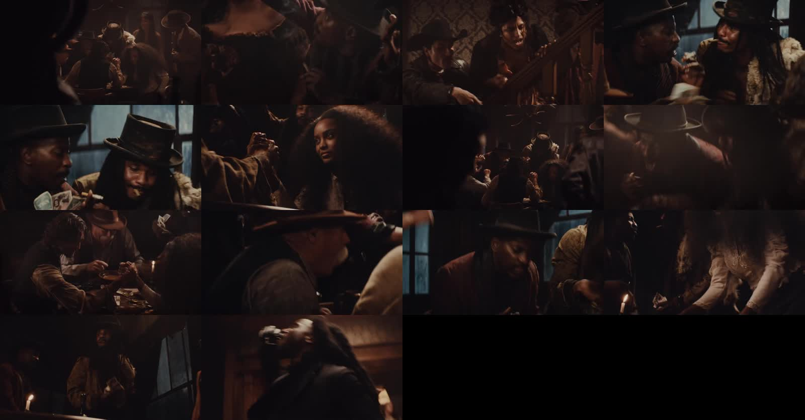
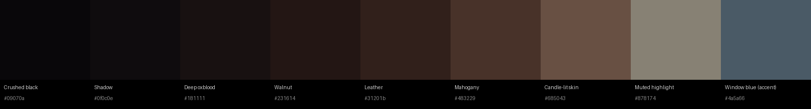

# Robel Clip: Mood Board

Reference: `Instagram1.mp4` (24.9 s, 1280×670, 24 fps). A candlelit Old West saloon:
gambling, arm-wrestling, cash and cigars, a crowd packed into a dark wooden room.

## Color tone

| Trait | Measured from the reference | What it means for Robel |
|---|---|---|
| Exposure | Average luma **37 / 255**. About 80% of pixels are darker than `#231614` | Very low-key. Faces sit just above the shadows. Don't light the whole room. |
| Saturation | Average **4.5** (scale is about 0–180) | Nearly monochrome. Pull saturation down hard, especially reds and greens. |
| White balance | U 126 / V 132 (slightly below and above neutral 128) | Warm amber/brown cast across the frame. |
| Blacks | Deepest tone `#09070a`, not pure black | Blacks are crushed, but with a faint warm lift and no clipping to 0. |
| Highlights | The brightest 2% average `#878174` | Highlights never hit white. They roll off into a dim cream. |
| Accent | Cool slate blue in the windows (`#4a5a66`) | The only cool color. Use it as backlight or rim light behind people. |

**Light sources:** candles on the tables, practical lamps and a chandelier, and cool daylight or
moonlight through the windows. Light is motivated, comes from one side, and falls off fast.
There is a little haze or smoke in the air to make the light visible.

**Wardrobe and art:** brown leather, oxblood, worn wool, wide-brim and top hats, dark wood and
damask wallpaper. One bright accent is allowed: the white blouse that the candle catches.

### Starter grade

`robel_saloon_look_v1.cube` is a 33-point 3D LUT built from the measurements above. It darkens
mids, applies a soft S-curve, removes most saturation (blues less), warms the shadows, lifts
blacks slightly toward warm, and rolls highlights off to cream. Load it on a node or adjustment
layer *after* a normal Rec.709 conversion, then balance exposure per shot. It's a starting point,
not a finished grade.

## Shot types

Average shot length is about **1.6 s** (15 cuts in 25 s). The edit is fast and rhythmic,
with the camera mostly handheld or on a slow push.

| # | Frame | Shot | Notes |
|---|---|---|---|
| 1 | `frames/s01.jpg` | **Wide establishing, foreground occlusion** | A dark silhouette fills one side of frame and the crowd is revealed past it. Slow push in. |
| 2 | `frames/s02.jpg` | **Medium close, body detail** | Corset or torso and hands, with the face partly cropped. Handheld. |
| 3 | `frames/s03.jpg` | **Medium two-shot on stairs** | Characters at different heights, with the wallpaper texture behind them. |
| 4–5 | `frames/s04.jpg`, `frames/s05.jpg` | **Low-angle tight two-shot** | Two men in hats, cash and cigars, with the blue window backlighting them. The hero shot of the look. |
| 6 | `frames/s06.jpg` | **Close-up, foreground action** | Heroine's face sharp, with arm-wrestling hands blurred in the foreground. Shallow depth of field. |
| 7 | `frames/s07.jpg` | **Wide from behind the crowd** | Backs of heads, chandelier, the room's depth falling into darkness. |
| 8 | `frames/s08.jpg` | **Soft-focus medium** | A rack focus or deliberately soft frame between beats. |
| 9 | `frames/s09.jpg` | **Medium-wide table action** | Arm-wrestle with a candle in frame as the light source. |
| 10 | `frames/s10.jpg` | **Extreme close-up, low angle** | Hat brim and profile, fast movement, a punch-in feel. |
| 11 | `frames/s11.jpg` | **Medium single with window backlight** | Face mostly shadow, with blue light outlining the hat. |
| 12 | `frames/s12.jpg` | **Medium on hands and table** | White blouse leaning into candlelight. Cards and money. |
| 13 | `frames/s13.jpg` | **Wide frame-in-frame** | Window panes behind, candle in the foreground, figures in silhouette. |
| 14 | `frames/s14.jpg` | **Low-angle tilt or whip** | Head thrown back, drinking or laughing. An energetic button to end on. |

### Rules of thumb for the Robel shoot

- Shoot through things: shoulders, hats and bodies in the foreground on most shots.
- Every frame needs a practical light (candle, lamp or window) visible or clearly motivated.
- Mix tight low angles with deep wides. Almost no neutral eye-level mediums.
- Use a wide aperture (shallow depth of field) and let backgrounds go to brown mush.
- Frame for about 1.9:1 (the reference is 1280×670). Letterbox if you deliver in 16:9.
- Cut on action (a slam, grab, toss or drink) to keep the pace of about 1.6 s per shot.

`contact-sheet.jpg` has one frame per second of the reference for a quick scan.
